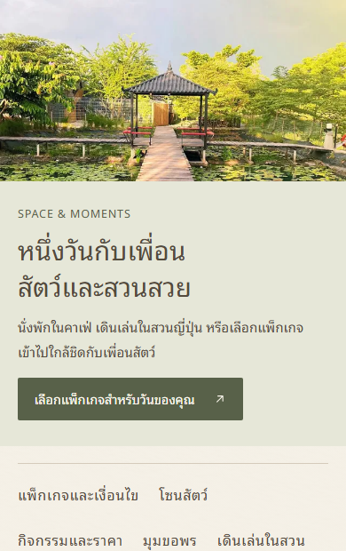
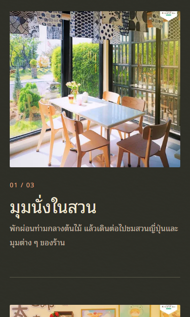

# ผลปรับคุณภาพโค้ด — 28 ตุลาคม 2026

สถานะ **PASS** บน product commit `acd198c49e17b9fdfd3fe2abeacae49a15e79ca7` หลังแก้ข้อพบจากรีวิวอิสระครบแล้ว งานนี้ commit ในเครื่อง ไม่มีการ deploy หรือเขียนข้อมูล production

รอ chat “ออกแบบระบบโหวตสัตว์ใน CMS” เสร็จและ deploy Three.js version `d99b1af6-25b6-45b3-8dfd-fd189c5afb30` ก่อนเริ่ม จากนั้นบันทึกงานเดิมเป็น checkpoint `e21f18ebe014fa3c0b551ef0dd49abd4f3b6c63f`

## สิ่งที่ปรับ

- ใช้ NewsCard และ EventGallery ร่วมกัน แยก HomeIntroduction/HomeStories และจัด Farm markup ให้อ่านง่าย
- คำแปลกิจกรรมและรูปสมาชิกอ้าง ID; สิทธิสมาชิกใช้ coupon/guest ID กับ entitlement โดยตรง เลิกแยกหรือเปรียบเทียบข้อความเพื่อคำนวณสิทธิ
- หน้าเว็บโหลดข่าวเฉพาะเมื่อใช้ และเริ่มอ่านข่าวพร้อมข้อมูลร้าน แก้ factory ที่ทำ timeout หาย พร้อมครอบคลุม body ที่ส่งค้างและ parent request ที่ยกเลิกแล้ว
- ตรวจ schema ของข่าวที่โหลดสำเร็จ ป้องกัน SDK ตีความ body ที่ timeout เป็นข้อมูลหาย; 404 จริงยังคงเป็น missing
- ลบ garden.css, watercolor.css, experience.css และ CSS ที่เลิกใช้ รวมค่าปัจจุบันไว้ใน tokens/global/site-chrome/content และไฟล์เฉพาะหน้า
- ลบ AnimalFamily, AnimalDoodle, VotePage ที่ไม่มีผู้เรียก, prop compact ที่ไม่ทำงาน และตัวแปรธีมเก่าที่ไม่มีผู้ใช้
- เพิ่ม Prettier/ไวยากรณ์ Astro และคำสั่ง `bun run format`, `bun run format:check`

## หลักฐาน

| การตรวจ | ผล |
|---|---|
| Astro check | 104 ไฟล์, 0 errors/warnings/hints |
| Unit tests | 45 ผ่าน, 365 assertions |
| Browser tests ด้วย fixture ในเครื่อง | 42 ผ่าน |
| Browser tests ของโหวต/Three.js กับ CMS แยก | 16 ผ่าน |
| CMS → MCP → Astro/workerd → vote integration | 43 assertions ผ่าน; SQLite/object storage ชั่วคราว |
| Content verifier | ไม่มี invalid; displayName/parkingNote ยังคงสถานะรอยืนยันเดิม |
| Formatting / diff check / build | ผ่าน |
| Voting/API TypeScript 7 ไฟล์ | เมื่อ normalize ด้วย formatter เดียวกัน ตรงกับ checkpoint ทุกไฟล์ |

Browser tests ใช้ local fixture ที่ port 4346, CMS ทดสอบแยกที่ 4341/8797 และข้อมูลคงที่สำหรับเทียบภาพที่ 4345/8798 ไม่ได้ส่งโหวตไป CMS จริง เซิร์ฟเวอร์ทดสอบหยุดแล้ว และ worktree ของผู้เขียนทั้งสามชุด archive แล้ว

เทียบภาพก่อน–หลัง 45 ชุด ครอบคลุมหน้าหลักทั้งสองภาษา ข่าว/รายละเอียดข่าว ฟาร์ม/รายละเอียดฟาร์ม ขนาด 320/390/768/1000/1440 และสถานะ light/dark/auto, hover, focus, เมนูมือถือ ข้อความ จำนวน element และขนาดรวมหน้าตรงกันทั้งหมด; 43 ชุดมี computed styles/ตำแหน่ง element ตรงกันทุกค่า

สองชุดของหน้ากิจกรรมต่างเฉพาะเศษพิกเซลของสัดส่วนภาพ responsive (สูงสุดประมาณ 0.24px) และ computed auto margin ที่ตำแหน่งจริงไม่เปลี่ยน ตรวจภาพแล้วเป็นภาพและการจัดวางเดิม 39 PNG ตรงกันระดับ bytes; มีอีกหนึ่งชุดที่ pixels ตรงกันแต่ encoding ต่างกัน ที่เหลือต่างจากการเลือกความละเอียดภาพ/การ rasterize จึงไม่ได้อ้างว่า PNG ทุกชุดเหมือนกันทุก pixel

หลักฐานเต็มในเครื่อง: `C:/Users/Sutti/.codex/artifacts/acupofzoo-code-quality-2026-10-28/` ประกอบด้วย before/after, comparison.json และ pixel-differences.json ตัวอย่างส่วนที่ตรวจภาพ:

| ก่อน | หลัง |
|---|---|
|  |  |
|  |  |

BrowserOS รีเซ็ต viewport ระหว่าง capture แบบ asynchronous จึงใช้ browser-test runtime ของโปรเจกต์เก็บภาพที่ยืนยันขนาด viewport ได้ ไม่ได้ใช้ภาพจาก BrowserOS เป็นหลักฐานเทียบ desktop

## การตรวจอิสระและข้อจำกัด

ผู้ตรวจเริ่มด้วยบริบทใหม่ อ่านอย่างเดียว และไม่ได้เป็นผู้เขียน ใช้ filesystem ร่วม จึงไม่ใช่เครื่องทดสอบที่แยกจากกัน ผู้ตรวจรัน unit/check/format/build และตรวจ source/ภาพเอง; ใช้ผล browser/CMS ที่ Root รันแล้วสำหรับ interaction และไม่รันโหวตชุดที่มี state ซ้ำ

รีวิวรอบแรก FAIL ที่ `a2c4f84` เพราะ timeout ของรายละเอียดข่าวกลายเป็น false 404 และมี token เก่าเหลือ แก้ด้วย regression ที่เห็น RED → GREEN และลบ token ทั้งหมด จากนั้นผู้ตรวจตรวจ delta สามไฟล์และให้ PASS ที่ `acd198c` ไม่มีข้อพบค้าง

Build ยังมีคำเตือนขนาด chunk มากกว่า 500kB จาก Three.js ตามเดิม ไม่ได้เปลี่ยนฟีเจอร์ 3D ในงานนี้ แผนและลำดับหลักฐานอยู่ใน [แผนปัจจุบัน](../../superpowers/plans/2026-10-28-code-quality-preserve-ui.md)
